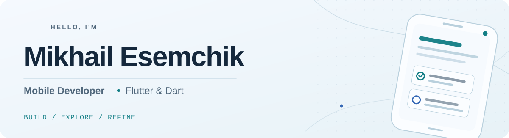

<!-- A quiet, evergreen profile: no counters, auto-generated stats, or project duplication. -->
<picture>
  <source media="(prefers-color-scheme: dark)" srcset="./assets/header-dark.svg" />
  <source media="(prefers-color-scheme: light)" srcset="./assets/header-light.svg" />
  
</picture>

### A little about me

I'm a developer who learns best by building. I like taking an idea from *"what if?"* to a working app, getting into the details along the way, and figuring out how to make the next iteration better than the last.

**Mobile is my home base, not my boundary.** Backend systems, AI, and automation are the areas I keep coming back to.

### My toolkit

| | Technologies |
| :--- | :--- |
| **Mobile** | `Flutter` `Dart` `Riverpod` `go_router` `Android` |
| **Backend & data** | `Supabase` `Firebase` `PostgreSQL` `REST APIs` `Hive` |
| **Quality & workflow** | `Git` `GitHub Actions` `Unit Testing` `Widget Testing` |
| **Beyond mobile** | `Python` `FastAPI` `OpenAI API` `RAG` |

### What keeps me curious

<table>
  <tr>
    <td width="33%" valign="top">
      <strong>01 / BUILD</strong>  
      Practical mobile apps with thoughtful interactions.
    </td>
    <td width="33%" valign="top">
      <strong>02 / EXPLORE</strong>  
      Backend systems, AI tools, and new ideas.
    </td>
    <td width="34%" valign="top">
      <strong>03 / REFINE</strong>  
      Architecture, testing, and smoother workflows.
    </td>
  </tr>
</table>

↓ A closer look at what I build is in my pinned repositories.

